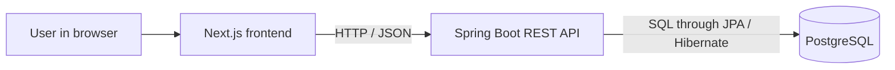

# System Architecture

## Phase 1

## Responsibilities

### Next.js

- Display equipment and forms.
- Validate input for immediate user feedback.
- Send requests to the backend.
- Show loading, success, and error states.

### Spring Boot

- Validate every request independently of the frontend.
- Apply business rules.
- Control database operations and transactions.
- Return explicit response DTOs and consistent errors.
- Enforce authentication and authorization when introduced.

### PostgreSQL

- Store application data.
- Enforce required fields, relationships, and uniqueness.
- Support transactional changes.

## Backend Structure

Start with a modular monolith: one deployable backend
organized by business capability.

Planned modules:
- Identity: organizations, memberships, and access.
- Operations: equipment, incidents, and maintenance tickets.
- Documents: document metadata, access, and processing status.
- AI workflows: approved integrations with the Python service.
- Audit: records of important actions.

Introduce modules as their features are implemented.

Modules must not access another module's repositories directly.
They communicate through explicit application interfaces.

## Why a Modular Monolith?

One application is easier to run, debug, test, and deploy
while requirements are evolving.

Module boundaries keep responsibilities clear without requiring
network calls between every business capability.

The trade-off is that modules share a deployment and must be
kept separate through code structure and engineering discipline.

## Future Python Service

Python will handle document retrieval and AI orchestration.
Spring Boot will remain responsible for business authorization
and transactional changes.

AI-generated actions must pass backend authorization and,
where required, human approval before execution.

## Phase 1 Security Boundary

Phase 1 is a local development application using one fixed
development organization.

This is not production authentication or tenant isolation.
Do not expose the application publicly until those controls
are implemented and tested.